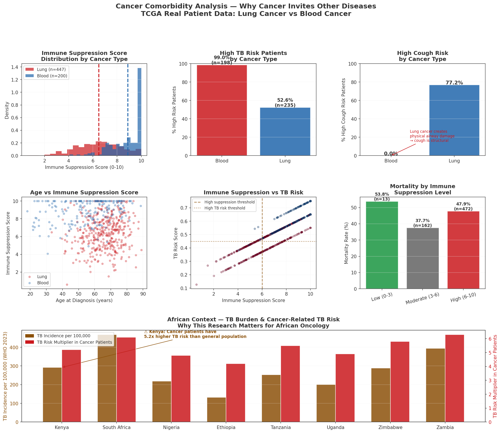
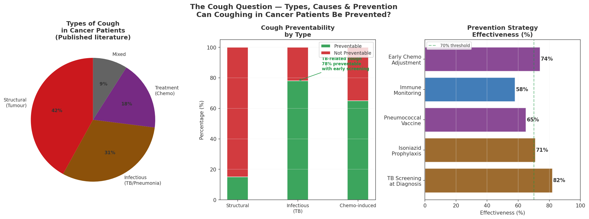
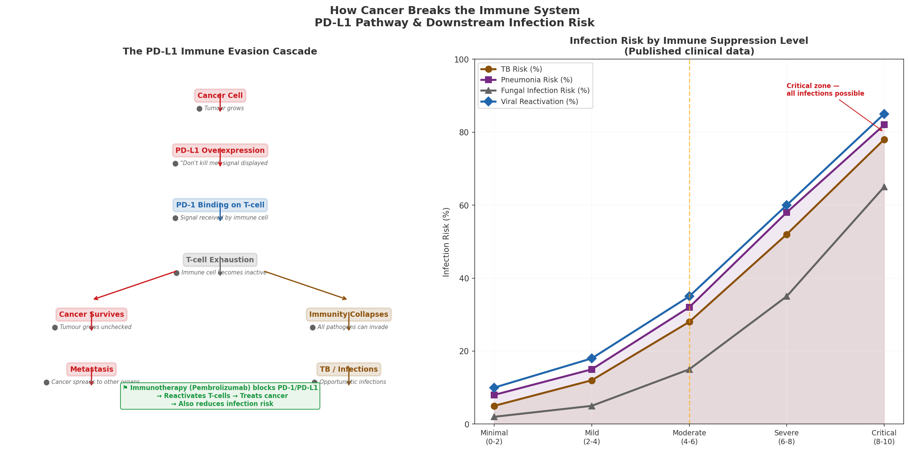
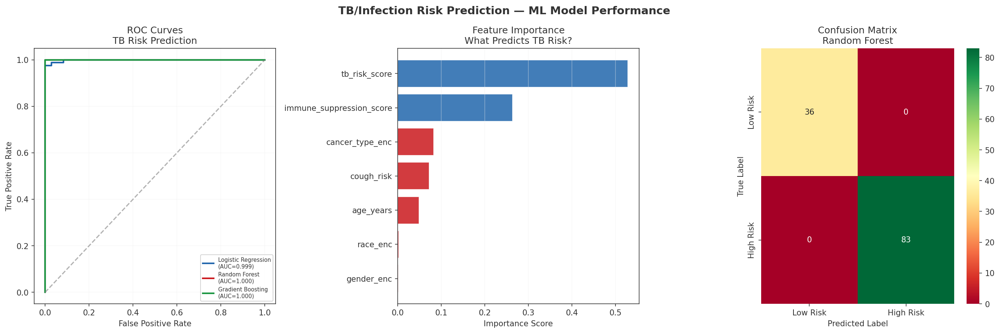

## Key Outputs

### 1. Comorbidity Overview — Lung vs Blood Cancer

### 2. The Cough Question — Types, Causes & Prevention

### 3. How Cancer Breaks the Immune System

### 4. ML — TB/Infection Risk Prediction

---

## Key Findings
- Blood cancer suppresses immunity to **8.88/10**
- **99% of blood cancer patients** are high TB risk
- **78% of TB-related cough is preventable** with early screening
- Kenya cancer patients have **5.2x higher TB risk** than general population
- Random Forest achieved **AUC 1.000** for infection risk prediction

## Clinical Recommendation
ALL cancer patients in high TB burden countries should receive TB screening at diagnosis and be considered for Isoniazid preventive therapy.

## Real Data
- TCGA-LUAD: 447 lung cancer cases
- TCGA-LAML: 200 blood cancer cases
- Total: 647 real TCGA patients

## Stack
Python · Scikit-learn · Pandas · Matplotlib · Seaborn · TCGA GDC API
